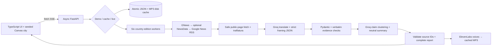

# News Bridge
### One story. A world of perspectives.

News Bridge compares how news **samples from six country editions** frame the same event. It retrieves coverage, translates it, identifies claims and loaded language, then builds a source-linked neutral briefing. A procedural night city turns those perspectives into districts: choose a theme and see where the light falls.

**Not a bias detector. Not a national opinion poll. A better starting point for media literacy.**

## Run in four commands

Requires Python 3.11+, [uv](https://docs.astral.sh/uv/getting-started/installation/), and Node 20.19+ or 22.12+. From the cloned repository:

```bash
uv sync --locked
npm --prefix frontend ci
npm --prefix frontend run build
uv run uvicorn backend.app:app --host 0.0.0.0 --port 8000
```

Open **http://localhost:8000**. Select a cached story. **No keys and no internet are needed after dependencies are installed.** The build bundles the fonts locally. In development, keep FastAPI running and use `npm --prefix frontend run dev -- --host 0.0.0.0 --port 3000` in a second terminal; open port 3000. Vite proxies `/api` and `/docs` to FastAPI; browser requests never point to localhost:8000.

For live retrieval/narration, copy `.env.example` to `.env`, add keys, and restart FastAPI:

```dotenv
GROQ_API_KEY=...
ELEVENLABS_API_KEY=...
NEWS_API_KEY=...
NEWS_PROVIDER=gnews
NEWSDATA_API_KEY=
```

`NEWS_API_KEY` may be a **GNews** or **NewsData.io** key. Set `NEWS_PROVIDER=newsdata` for a NewsData key (usually starts with `pub_`). With GNews primary, optional `NEWSDATA_API_KEY` enables the backup before RSS. `.env` and runtime caches are ignored; never commit credentials. Missing Groq/news keys automatically use a matching cached demo; unknown demo queries return an actionable error rather than unrelated fabricated coverage. Missing ElevenLabs key still permits cached audio.

## The experience

- **A city that wakes up:** original seeded Canvas 2D skyline, windows, towers, bridge, traffic and water reflections. First-visit 5.5-second intro, skip, reduced-motion support, hidden-tab pause.
- **Six editions, in parallel:** US, UK, France, Germany, Japan, India. Up to two sources per edition; bounded feed timeouts and independent failure states.
- **Same story, different lens:** original headline and English translation, tone, loaded-word explanations, theme tags, evidence sufficiency estimates and original links.
- **The perspective map:** select economy, security, human cost, diplomacy, accountability or innovation. District light follows emphasis. A keyboard-accessible numbered matrix presents exactly the same values.
- **Evidence Lock:** every nonzero theme score requires a verbatim original-text quote; click a district/cell to inspect it. Schema-valid but unsupported quotations are rejected.
- **Claim Cross-check:** shared, single-source, different-emphasis and disputed claims with citations. Agreement is not truth or independent verification.
- **Missing Voices:** questions about absent perspectives in *this sample*, not assertions of deliberate suppression.
- **Three captured events:** COP28, Chandrayaan-3, Paris Olympics. Pre-generated Groq briefings in English, Spanish and French; recorded source URLs and capture times. Demo playback never calls an external API.
- **Multi-voice audio:** ElevenLabs country perspectives and neutral briefing, written transcript, MP3 disk cache. No autoplay; demo speech is generated by an explicit preparation script, never during playback. English audio is cached for all seven Moon/Olympics tracks and four refined COP28 tracks; missing tracks display an honest error. Spanish/French audio is not cached.
- **Quiet polish:** local Bricolage Grotesque + Source Serif 4, dark ink/amber/cyan tokens, command palette, original headline toggle, simple briefing, source filters, report permalinks and browser print/Save as PDF.

## Architecture



Presentation, retrieval, analysis, and synthesis are separate modules. `backend/models.py` defines the JSON contracts; prompts are standalone text files under `backend/prompts/`. Groq structured outputs use `openai/gpt-oss-120b` and JSON Schema, not regex extraction or “please return JSON” alone. Both schema and evidence are validated. Synthesis uses compact claim/score inputs rather than duplicating full article text.

### What AI automates
1. Translate available foreign-language coverage into a common reading language.
2. Extract claims/actors, explain loaded terms, classify tone and score six themes.
3. Group claim-level common ground/differences across sources.
4. Write a neutral, cited briefing and age-13 explanation in the chosen language.
5. Suggest missing perspectives and narrate the briefing with distinct voices.

The developer-written pipeline handles discovery, caching, retries, concurrency, validation and presentation. AI is responsible for language and interpretation—not fetching, source truth, or deciding what a country believes.

### Reliability and budgets
- Feed workers: 32 seconds each. Live pipeline: 240 seconds overall. Up to two simultaneous reports and two Groq calls per report.
- Three bounded retry attempts for 429, transient 5xx and network errors, exponential jitter and bounded `Retry-After`.
- SHA-256 cache keys include query/country, source text, model, or language as appropriate. Feed/report cache TTL is one hour; saved analyses/audio/demo packs persist.
- Full-text extraction: public HTTP(S) destinations only, private-address rejection, redirect checks, 7-second timeout and 1.5 MB page cap. Paywalls/dead pages keep title/excerpt evidence. RSS redirects are not claimed to be full articles.
- SSE streams actual stages; cached demos immediately report ready—no fake waiting timer. Cancel stops work when the streaming connection closes.
- Static city raster is cached per size, device pixel ratio capped at 1.5. Runtime instrumentation is exposed as `window.newsBridgePerformance`. A 60fps mid-range-laptop measurement is still required; no speed claim is made from a VM build.

## Verification

```bash
uv run python -m pytest -q
uv run ruff check backend scripts
npm --prefix frontend test
npm --prefix frontend run typecheck
uv run python -m scripts.check_contrast
```

To print the first vertical slice: `uv run python -m scripts.slice1` (three country JSON analyses). With the dev frontend running: `uv run python -m scripts.verify` checks the actual proxy/SSE/report interface and records request timing in `docs/http-verification.json`.

Tests cover XML safety, cache atomicity, schema constraints, exact quote validation, confidence caps, source ID validation, missing-key demo fallback, no-network demos, retries, stream completion, permalinks, cached MP3 delivery, and actual UI handlers through a DOM implementation. **DOM tests are not real-browser pixel/accessibility/performance tests.** Use [the release checklist](docs/RELEASE.md) before recording.

## Demo preparation and deliverables

- [2:30 demo script](docs/DEMO.md) — hook, walkthrough, 30-second code tour, impact close.
- [Devpost draft](docs/DEVPOST.md) — explicitly mapped to all four judging criteria.
- [Acceptance ledger](docs/ACCEPTANCE.md) — implemented constraints and honest cuts.
- [Judge review](docs/JUDGE_REVIEW.md) — scores and weakest-area repair.
- [Release checklist](docs/RELEASE.md) — browser checks, screenshots, public repo, video and safe publication.

To recapture real event data (requires Groq, network, and credits): `uv run python -m scripts.prefetch`. To improve the flagship publisher sample: `uv run python -m scripts.refine_demo`. To generate cached demo speech once: `uv run python -m scripts.cache_audio`. These scripts log stage names, not keys. Respect provider limits and content terms; do not expose or redistribute full copyrighted articles. The committed demo pack contains linked headlines and AI outputs, not article bodies.

## Limitations and ethics

“Country” means **news edition**, not guaranteed outlet nationality or public opinion. Feed results may include foreign publishers or syndication. A headline-only score describes very little evidence; confidence is capped at 45%, but is an **uncalibrated AI sufficiency estimate**, not a statistical probability. A zero means not visible in the retrieved text, not absent from the full reporting. Quote matching proves provenance, not correct interpretation. Source agreement can come from shared wire copy; we do not present it as corroboration.

Original headlines stay in the original script. Headline translations are English; synthesized briefs support six languages live and three cached. Live feeds may return unrelated matches; relevance screening and stronger multilingual query expansion remain future work. Historical demos use time-bounded RSS searches because free news “latest” plans are not historical archives.

**Current provider limits:** Groq’s daily token quota blocked the final full-text live smoke test. Output-length controls were repaired, but a successful live rerun remains pending quota reset. ElevenLabs reached 9,889/10,000 characters, so further generation was stopped. The nine cached event/language combinations remain functional.

No public production deployment has been made. The private dev preview is for review. A Python server with trafilatura needs a Python-capable host; it cannot be uploaded as a normal Cloudflare Worker. Before public hosting, add per-user quotas/authentication so visitors cannot exhaust paid API credits; rotate any exposed keys. Sharing currently relies on this server retaining its disk cache.

All project code, canvas art, prompts, and fixture capture scripts were created for this event. Open-source dependencies/typefaces and third-party APIs are credited in [ATTRIBUTION.md](docs/ATTRIBUTION.md). **The actual screenshots, public repository verification, and recorded video remain release tasks, not claimed deliverables.**
